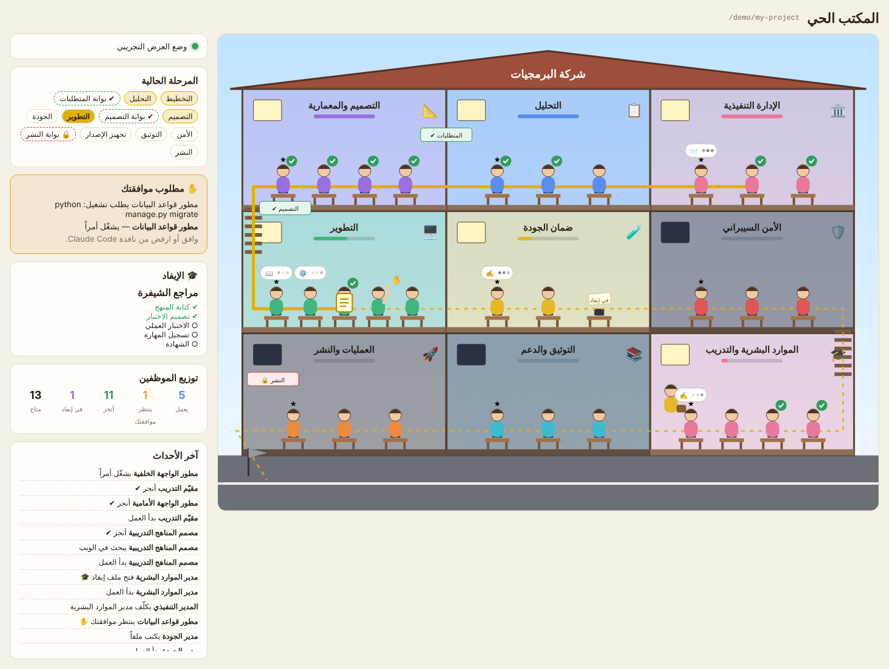

# المكتب الحي

واجهة ويب ترى فيها موظفي الشركة يعملون: مبنى من ثلاثة طوابق مكشوف كبيت الدمى، كل غرفة قسم. المكتب **يستمع** للجلسة فقط ولا يديرها.



## التشغيل (مرة واحدة على جهازك، يخدم كل المشاريع)

```bash
cd live-office/frontend && npm install && npm run build
```

```bash
cd live-office/backend && python -m venv .venv && . .venv/bin/activate && pip install -r requirements.txt
```

```bash
python manage.py runserver 8000
```

افتح <http://localhost:8000/>. للعرض التجريبي دون جلسة: <http://localhost:8000/?demo>.

للتطوير على الواجهة: `npm run dev` ثم <http://localhost:5173/> (يمرّر `/office` و`/ws` إلى المنفذ 8000).

## كيف تصله الأحداث
خطافات `http` في `.claude/settings.json` ترسل `SubagentStart` و`SubagentStop` و`PreToolUse` و`PermissionRequest` إلى `POST /office/events/`.

| الحدث | ما تراه |
|---|---|
| `SubagentStart` | الموظف يجلس إلى مكتبه |
| `PreToolUse` | فقاعة: يقرأ، يكتب، يشغّل أمراً، يكلّف… |
| `PermissionRequest` | يرفع يده: ينتظر موافقتك |
| `SubagentStop` | علامة إنجاز خضراء |
| كتابة ملف في `docs/hr/missions/` | الموظف المُوفَد يحمل حقيبته إلى غرفة التدريب |

شريط المراحل والبوابات ونِسَب الأقسام تُقرأ من `docs/00-management/status.json` للمشروع (يُستطلع كل 3 ثوانٍ).

## ضمانات
- الخادم يردّ دائماً **204** بلا محتوى، فلا يغيّر أي قرار في الجلسة. المهلة ثانيتان.
- لا يُحفظ أي محتوى حساس: لا نص أوامر، ولا محتوى ملفات، ولا مسارات (سوى اسم ملف الإيفاد). انظر `backend/office/sanitize.py`.
- يستمع على `localhost` فقط والحالة في الذاكرة.
- `/office/status/` لا يقرأ إلا مشاريع وصلت منها أحداث.

## الاختبارات
```bash
cd live-office/backend && pytest -q
```

قائمة الموظفين في `frontend/src/roster.js` مولّدة من `scripts/gen_agents.py`.
